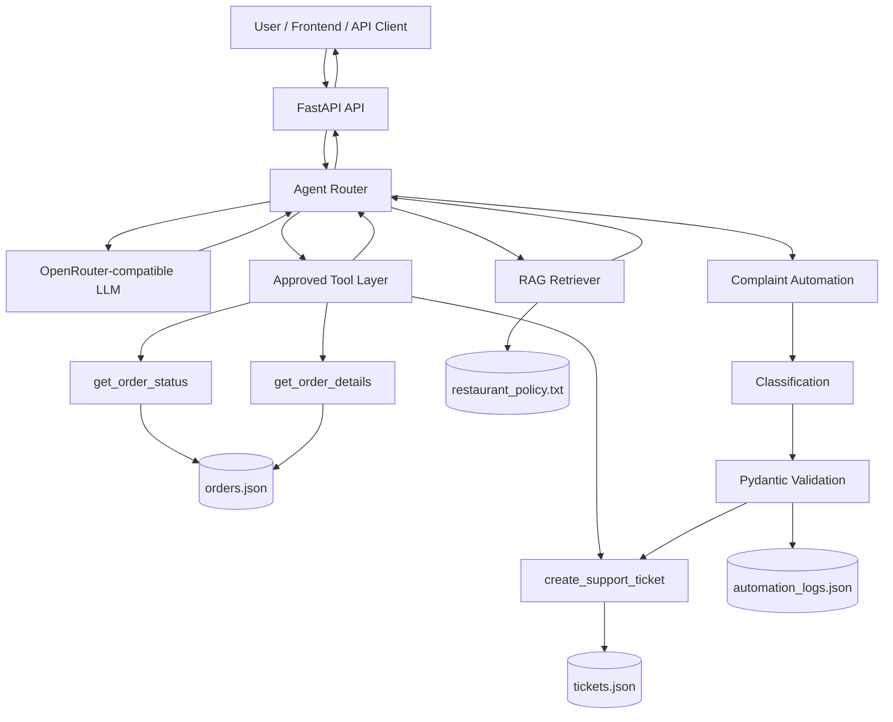

# Architecture — Restaurant Support & Operations AI Agent

## High-level flow



## Security boundary

The LLM does not directly access the filesystem, database, shell, SQL, or arbitrary APIs.

The application exposes only approved tools:

- `get_order_status`
- `get_order_details`
- `create_support_ticket`

Application code validates tool arguments and business rules before execution.

## Data flow

### Order request

```text
User
 → /api/agent/chat
 → agent detects order request
 → validate order ID
 → get_order_status()
 → orders.json
 → authoritative result
 → natural-language response
```

### Policy request

```text
User
 → /api/agent/chat
 → policy intent
 → retrieve_knowledge()
 → restaurant_policy.txt
 → relevant sections
 → grounded response
```

### Complaint

```text
User
 → /api/agent/chat
 → complaint detection
 → AI classification
 → Pydantic validation
 → create_support_ticket()
 → tickets.json
 → automation_logs.json
```
